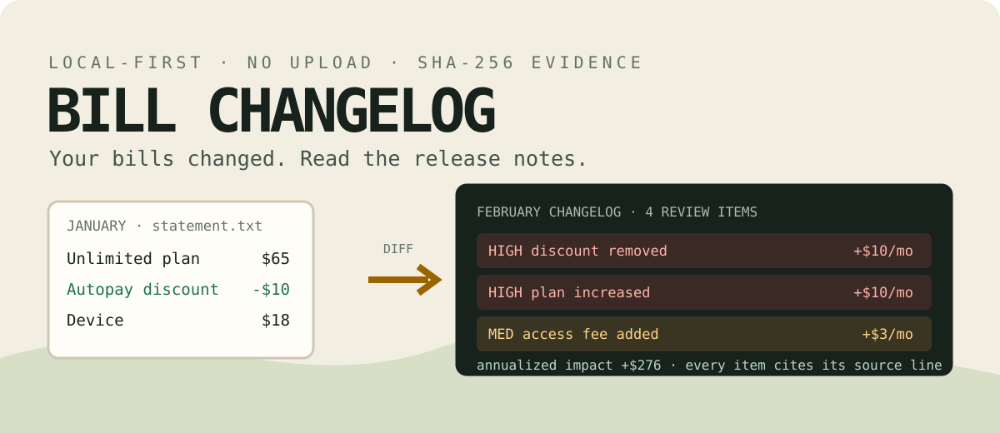

<p align="center">
  
</p>

# Bill Changelog

[](https://github.com/KanadeK/bill-changelog/actions/workflows/ci.yml)
[](https://github.com/KanadeK/bill-changelog/actions/workflows/codeql.yml)
[](https://github.com/KanadeK/bill-changelog/releases/latest)
[](https://www.python.org/)
[](LICENSE)

Your recurring bills change. They rarely ship release notes.

Bill Changelog is a local-first, evidence-linked `git diff` for phone, internet, utility,
insurance, and SaaS bills. Give it two statements and it identifies new charges, removed
discounts, price changes, renamed items, and their monthly and annualized impact—without bank
login, cloud upload, API key, or AI guesswork.

```text
4 change(s), 2 high; total USD +23.35; monthly USD +23.00; annualized USD +276.00
```

## Why this is not another finance dashboard

| Typical tool | Bill Changelog |
|---|---|
| Categorizes bank transactions | Compares the actual line items printed on two bills |
| Tracks due dates or subscriptions | Explains what changed between billing periods |
| Uploads documents for OCR/AI | Parses locally and never makes a network request |
| Gives an opaque alert | Cites the source page/line and excerpt for every finding |
| Stores a mutable dashboard | Exports a portable report plus SHA-256 manifest |

See the dated [gap research](docs/research.md) for exact GitHub queries, competitors, demand
signals, and limitations of the “no direct match found” conclusion.

## Try the complete demo

With Python 3.10 or newer:

```bash
python -m pip install "bill_changelog-0.1.0-py3-none-any.whl"
billchangelog demo --output billchangelog-demo
billchangelog verify billchangelog-demo
```

From a source checkout:

```bash
uv sync --extra dev --locked
uv run billchangelog demo --output billchangelog-demo
uv run billchangelog verify billchangelog-demo
```

The fictional demo catches:

- a monthly plan increase from USD 65 to USD 75;
- a removed USD 10 autopay discount;
- a new USD 3 monthly access fee;
- a USD 0.35 tax change;
- USD 23/month and USD 276/year of detected recurring impact.

It writes a self-contained HTML report, machine JSON, CSV, a Markdown support evidence pack,
and a tamper-evident manifest.

## Compare your own bills

```bash
billchangelog compare january.pdf february.pdf \
  --output my-bill-changelog
billchangelog verify my-bill-changelog
```

Provider-specific aliases and thresholds live in a small JSON profile:

```bash
billchangelog compare old.txt new.txt \
  --profile examples/acme-mobile-profile.json \
  --output report
```

On PowerShell, put the command on one line or use PowerShell's backtick continuation instead of
the backslashes shown above.

## Real input support

| Format | What is read | Evidence locator |
|---|---|---|
| `.txt`, `.md` | Metadata and line items | line number |
| `.csv` | Named line-item columns | row number |
| `.json` | Canonical captured snapshot | preserved evidence |
| `.eml` | Plain/HTML body and PDF attachments | body/attachment + line/page |
| `.pdf` | Embedded text via pypdf | page + extracted line |

Use `capture` when you want to review or correct extraction before comparing:

```bash
billchangelog capture statement.pdf --output statement.json
billchangelog compare statement.json next-month.pdf --output report
```

The input contract, CSV columns, canonical JSON, amount conventions, and profile schema are in
[docs/formats.md](docs/formats.md).

## Commands and exit codes

```text
billchangelog capture INPUT --output SNAPSHOT.json
billchangelog compare BEFORE AFTER --output DIRECTORY
billchangelog verify DIRECTORY
billchangelog demo --output DIRECTORY
billchangelog doctor
```

- `0`: command completed; or no configured comparison threshold was crossed.
- `1`: `compare --fail-on ...` found a matching severity.
- `2`: invalid input, extraction failure, unsafe overwrite, or failed bundle verification.

Reports are not overwritten unless `--force` is explicit. For automation:

```bash
billchangelog compare old.pdf new.pdf --output report --fail-on high
```

## Privacy and evidence rules

- Runtime code contains no HTTP client and makes no network calls.
- Report evidence masks likely account, phone, card, and email identifiers by default.
- Original files are hashed but never copied into the report bundle.
- `--include-sensitive-evidence` is an explicit opt-in for an unmasked local report.
- HTML escapes statement text; tests cover script-tag injection.
- `manifest.json` records every generated artifact hash and size; `verify` detects edits.

Read the [security model](docs/security.md) before using sensitive statements.

## Honest limitations

- Scanned/image-only PDFs need OCR before capture; Bill Changelog does not silently invent text.
- Generic parsing is heuristic. Review cited excerpts, and use a profile or captured JSON when a
  provider has an unusual layout.
- Currency conversion is deliberately absent. Both statements must use one currency.
- “Monthly” impact is annualized only when cadence is explicit or profile-derived.
- A finding means “review this difference,” not “this charge is unauthorized” or legal advice.
- EML attachments other than PDF are reported as ignored rather than parsed incompletely.

## Acceptance and release gate

The repository's one-command gate runs lint, format, strict typing, coverage, a secret scan,
dependency audit, two deliberately separated release builds, byte-for-byte determinism checks,
portable `.pyz` smoke tests, a clean-wheel install, and demo verification:

```bash
uv sync --extra dev --locked
uv run python scripts/verify.py
```

Expected final line:

```text
ALL ACCEPTANCE CHECKS PASSED
```

Release assets are built with:

```bash
uv run python scripts/package_release.py --output release-dist
```

If any command fails, follow the symptom-to-fix flow in [docs/repair.md](docs/repair.md). It lists
the exact rerun command for parser failures, OCR-only PDFs, false matches, dependency audit
findings, non-deterministic archives, dirty Git state, CI failures, and checksum mismatches.

## Contributing

The highest-leverage contributions are anonymized bill fixtures, provider profiles, locale amount
formats, and extraction regression tests. See [CONTRIBUTING.md](CONTRIBUTING.md).

## License

[MIT](LICENSE) © 2026 KanadeK.
